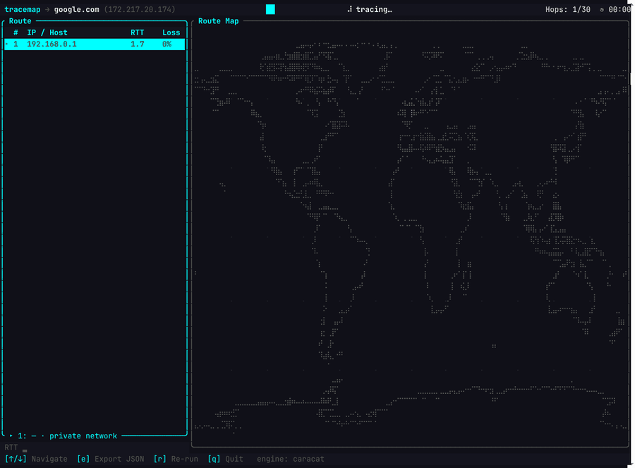
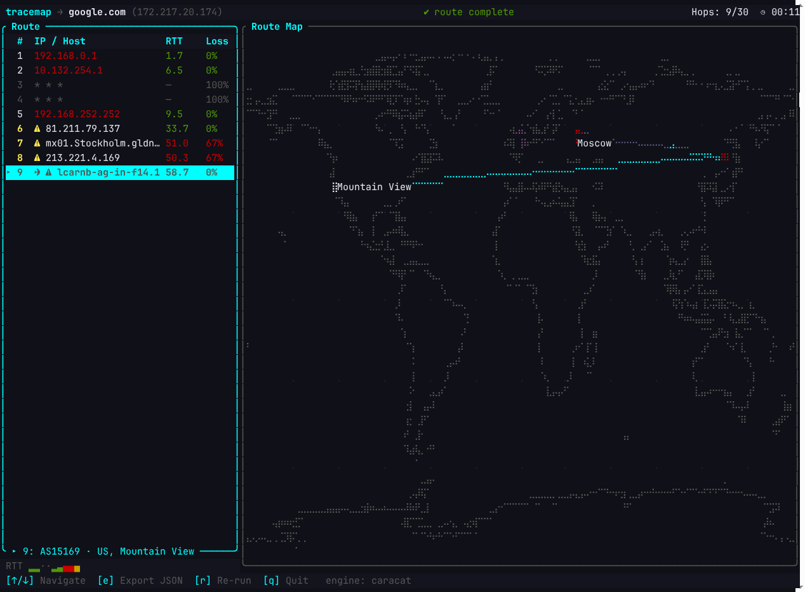
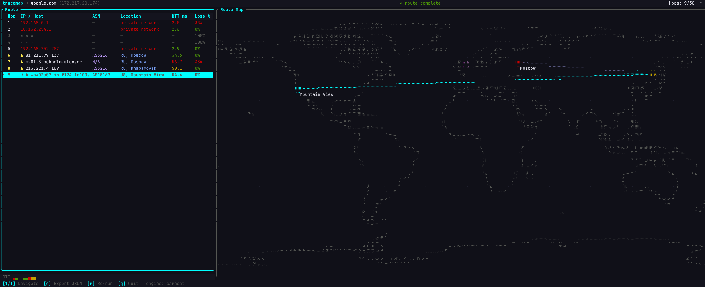
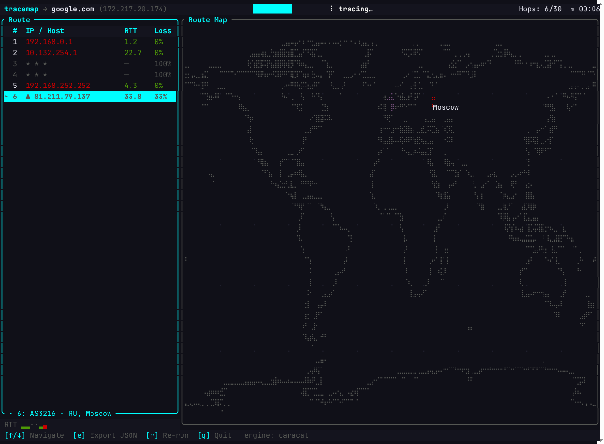
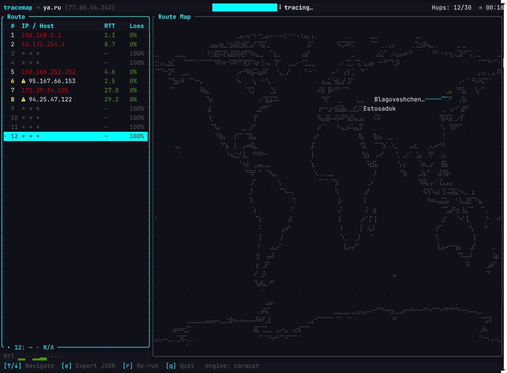

<div align="center">

```
┌┐┌┌─┐┌┬┐┬─┐┌─┐┌─┐┌─┐┬─┐┌┐┌
│││├┤  │ ├┬┘├┤ │  │ │├┬│││
┘└┘└─┘ ┴ ┴─└─┘─┘└─┘┴└─┘└┘
```

# netrecorn · tracemap

**Cyber-recon traceroute TUI** — весь маршрут до хоста в терминале:
живая таблица хопов, карта мира на Braille-символах, ASN/геолокация каждого узла.

[](https://github.com/sudxxt-afk/netrecorn/actions/workflows/ci.yml)
[](LICENSE)
[](https://www.rust-lang.org)
[](#-быстрый-старт)
[](https://ratatui.rs)
[](https://github.com/sudxxt-afk/netrecorn)
[](https://github.com/sudxxt-afk/netrecorn/commits/main)
[](https://github.com/sudxxt-afk/netrecorn/pulls)
[](https://github.com/sudxxt-afk/netrecorn/stargazers)



*Живая трассировка: хопы появляются в реальном времени, ripple-кольца на карте,
бегущие пакеты вдоль маршрута, RTT-профиль под таблицей.*

</div>

---

## ⚡ Быстрый старт

```bash
# зависимость сборки: libpcap
sudo dnf install libpcap-devel        # Fedora
# sudo apt install libpcap-dev        # Debian/Ubuntu
# brew install libpcap                # macOS

cargo build --release

# права на сырые сокеты — один раз:
sudo setcap cap_net_raw,cap_net_admin+ep target/release/tracemap

# запуск из любой директории:
mkdir -p ~/.local/bin
cp target/release/tracemap ~/.local/bin/netrecorn
netrecorn google.com
```

Или просто `sudo ./target/release/tracemap google.com`.
Без прав приложение само переключится на системный `traceroute`, а если и он
не может — покажет понятную ошибку с подсказкой.

## 🎮 Управление

| Клавиша | Действие |
|---|---|
| `↑` / `↓` (`k` / `j`) | навигация по хопам (выделение следует за фронтом, пока не тронешь стрелки) |
| `Home` / `End` | первый / последний хоп |
| `e` | экспорт маршрута в `tracemap_<host>_<timestamp>.json` |
| `r` | перезапустить трассировку |
| `q` / `Esc` | выход |

## 🧭 Что внутри

- **Движок**: [`caracat`](https://crates.io/crates/caracat) — Paris-traceroute
  на сырых сокетах (ICMP / ICMPv6, 3 пробы на хоп, до 30 хопов), потоково в UI
  через mpsc. Fallback на системный `traceroute` без прав.
- **GeoIP + ASN**: ip-api.com (≤5 concurrent, дисковый кэш 30 дней) + reverse DNS.
  API лёг — `N/A`, UI не блокируется никогда.
- **Карта мира**: `MapResolution::High` + Braille, радарная сетка, маршрут
  линиями, точки в цвет RTT, magenta-пин «ты», ripple при появлении хопа,
  «дышащие» узлы, бегущие пакеты, пульс фронта, мигающая цель и arrival-ping.
  На широких терминалах карта занимает **70%** экрана.
- **Таблица**: Hop / IP-Host / ASN / Location / RTT / Loss с цветовым кодом
  (`<50ms` 🟢, `50–150` 🟡, `>150` или потери 🔴), `* * *` для молчащих,
  красные private-IP, `✈` смена континента, `⚠` хостинг/облако или risk-страна.
  В slim-режиме ASN/город выбранного хопа — в строке деталей под таблицей.
- **RTT-профиль**: строка баров `▂▃▄▅▆▇█` по хопам — форма латентности маршрута
  одним взглядом.
- **Экспорт**: стабильный JSON (`hop, ip, asn, country, city, lat, lon, rtt_ms,
  loss_pct`) — готов для jq и скриптов.
- **Тёмная cyber-recon тема** из коробки: near-black фон, неоновый cyan,
  токийские фиолетовый/синий в колонках, скруглённые панели.

## 🖼 Скриншоты

<div align="center">

| Маршрут завершён (slim + карта 70%) | Полная таблица (широкий терминал) |
|---|---|
|  |  |

| Трассировка в полёте | Маршрут по России (ya.ru) |
|---|---|
|  |  |

</div>

## 🔐 Права на сырые сокеты

caracat инжектит пакеты и слушает ICMP через libpcap → нужен root или capabilities:

```bash
sudo setcap cap_net_raw,cap_net_admin+ep ./netrecorn   # Linux, дальше без sudo
sudo ./netrecorn google.com                            # macOS / ленивый вариант
```

> После каждой пересборки бинарника capabilities слетают — выдай заново.

## 📦 Формат экспорта

```json
[
  {
    "hop": 8,
    "ip": "173.194.121.4",
    "asn": "AS15169",
    "country": "United States",
    "city": "Mountain View",
    "lat": 37.4056,
    "lon": -122.0775,
    "rtt_ms": 52.41,
    "loss_pct": 0.0
  }
]
```

## 🏗 Архитектура

```
src/
├── main.rs      # args, ratatui init/restore, tokio select-loop (keys / net / tick)
├── app.rs       # состояние: Vec<Hop>, selection, run lifecycle (run_id), export
├── network.rs   # caracat blocking-worker + fallback, GeoIP/reverse-DNS enrichment
├── ui.rs        # header / table / RTT-profile / Canvas(Map) / footer, палитра
└── models.rs    # Hop, GeoInfo, NetEvent, ExportHop, континенты, risk-эвристики
```

Сетевой слой шлёт `RunEvent { run_id, event }` в mpsc: события прерванного
запуска игнорируются. Блокирующие чтения pcap вынесены в воркер-поток с
`recv_timeout` — крейт `pcap` проглатывает таймауты, и это единственный способ
гарантировать deadline на молчащий хоп. Geo-кэш: `~/.cache/tracemap/geo.json`.

## 🧰 Troubleshooting

| Симптом | Лечение |
|---|---|
| `Raw socket permission denied…` | `sudo` или `setcap` (см. выше) |
| GeoIP = `N/A` | ip-api недоступен/лимит; кэш подтянет при следующем запуске |
| Mapa пустая | у хопов ещё нет координат или все private/молчащие |
| Сборка падает на `pcap` | нет `libpcap-devel` / `libpcap-dev` |
| `failed to initialize terminal` | запускай в настоящем терминале (TTY), не в панели IDE |

## 🛣 Roadmap

- [ ] fullscreen-карта по `m`
- [ ] переключатель тем (`t`): Tokyo Night / Catppuccin / Dracula / matrix
- [ ] sparkline RTT выбранного хопа во времени
- [ ] легенда карты по `?`
- [ ] IPv6-маршруты на карте (движок уже умеет ICMPv6)

## 📄 Лицензия

[MIT](LICENSE) © sudxxt-afk

<div align="center">

**Сделано на 🦀 + [ratatui](https://ratatui.rs) · если понравилось — ⭐ репо**

</div>
